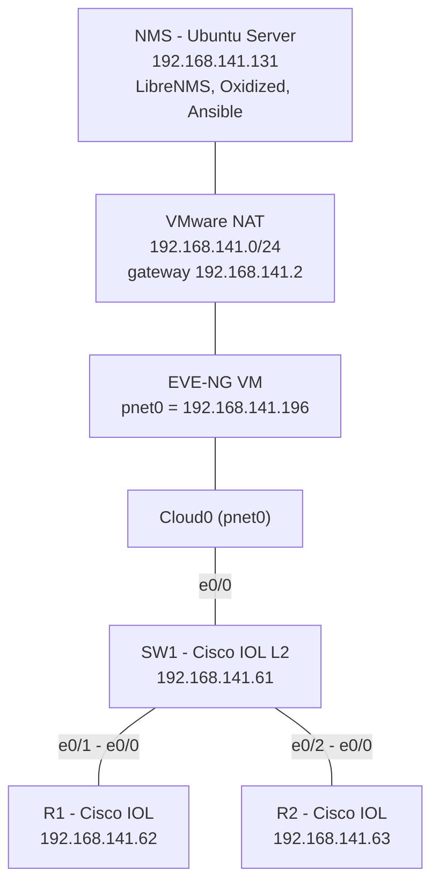

# Topology và quy hoạch IP

## Sơ đồ

## Quy hoạch IP

| Thiết bị | Vai trò | IP | Ghi chú |
|---|---|---|---|
| NMS (Ubuntu Server) | Máy giám sát và tự động hóa | 192.168.141.131/24 | Gateway 192.168.141.2, card `ens33` |
| EVE-NG VM | Chạy các node IOL | 192.168.141.196/24 | Card `pnet0` nằm trên mạng NAT |
| SW1 | Switch L2 | 192.168.141.61/24 | IP quản trị trên `Vlan1`, `ip default-gateway 192.168.141.2` |
| R1 | Router | 192.168.141.62/24 | `Ethernet0/0`, default route tới `.2` |
| R2 | Router | 192.168.141.63/24 | `Ethernet0/0`, default route tới `.2` |

Các IP `.61` đến `.63` nằm ngoài dải DHCP mặc định của VMware NAT (`.128` đến `.254`), nên không trùng với máy khác.

## Vì sao thiết kế như vậy

- Máy NMS dùng luôn mạng NAT đang có (có Internet để kéo image Docker), nên không cần thêm card mạng hay định tuyến giữa hai mạng.
- `Cloud0` của EVE-NG ứng với card đầu tiên của VM EVE-NG, vốn nằm trên mạng NAT. Nối `e0/0` của SW1 vào `Cloud0` đưa cả lab vào cùng subnet với NMS.
- Toàn bộ thiết bị trong một subnet, không cần định tuyến, nên lỗi dễ khoanh vùng và dễ giải thích.
- Topology tối thiểu (1 switch, 2 router) đủ để thể hiện giám sát, sao lưu và tự động hóa theo nhóm (`switches`, `routers`).
