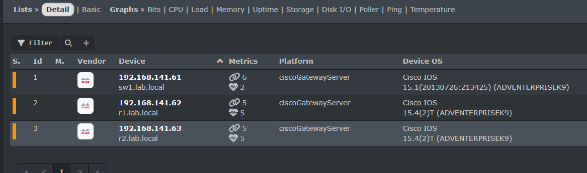
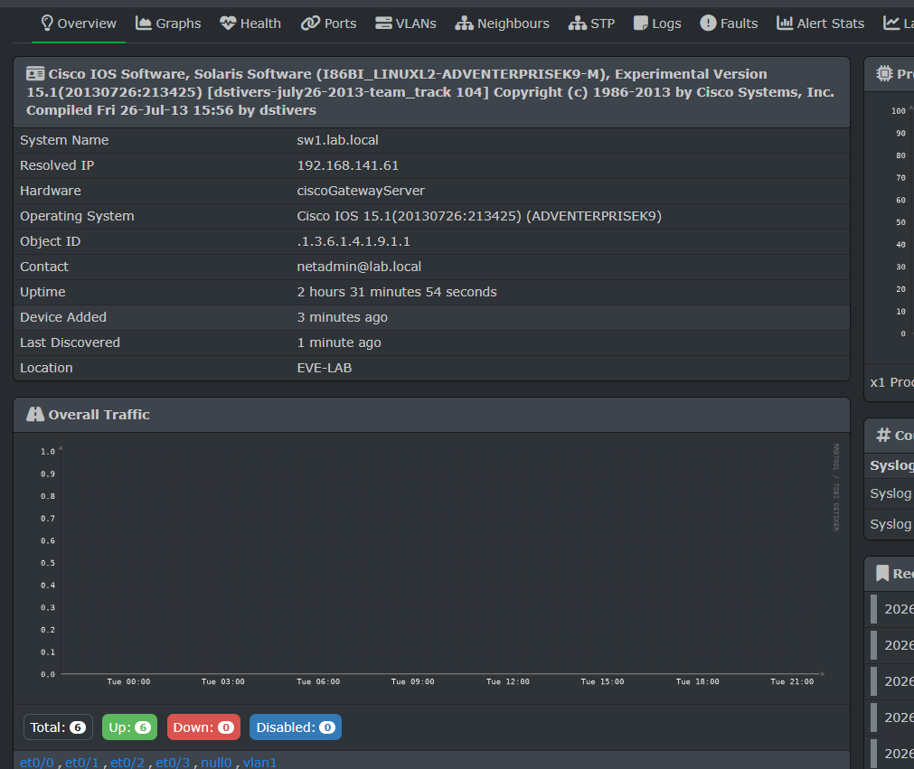
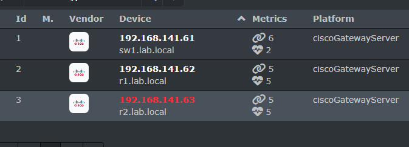
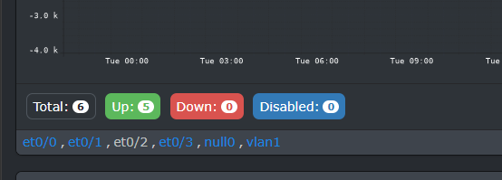

# 03 - LibreNMS: giám sát bằng Docker

## Thành phần

| Container | Vai trò |
|---|---|
| `librenms` | Giao diện web (cổng 8000) |
| `librenms-dispatcher` | Tiến trình nền hỏi SNMP (polling) theo chu kỳ |
| `librenms-db` (MariaDB) | Lưu dữ liệu bền vững: thiết bị, cổng, người dùng, luật cảnh báo, sự kiện |
| `librenms-redis` | Cache, session, điều phối giữa các tiến trình polling (dữ liệu tạm trên RAM) |

Số liệu biểu đồ (băng thông, CPU theo thời gian) nằm ở file RRD trong volume `librenms-data`, không nằm trong MariaDB.

## Triển khai

```
cd docker
cp .env.example .env        # sua mat khau
docker compose config -q && echo "File hop le"
docker compose up -d
docker compose ps
```

File [docker/compose.yml](../docker/compose.yml) dựa trên [file mẫu LibreNMS](https://docs.librenms.org/Installation/Docker/), đổi mật khẩu sang `.env` và lược bỏ các phần không cần (syslog, trap, mail).

Lần đầu truy cập `http://192.168.141.131:8000`, tạo tài khoản admin, rồi vào trang **Validate** để kiểm tra. Mục này từng báo lỗi lệch múi giờ giữa MariaDB và PHP, xem [mục 1 troubleshooting](../07-troubleshooting/README.md#1-librenms-validate-báo-lệch-giờ-giữa-mysql-và-php).

## Thêm thiết bị

**Devices > Add Device**, điền cho từng thiết bị:

| Ô | Giá trị |
|---|---|
| Hostname or IP | `192.168.141.61` (rồi `.62`, `.63`) |
| SNMP version | v2c |
| Port / Transport | 161 / udp |
| Community | `<SNMP_COMMUNITY>` |

Dùng IP thay vì tên vì lab không có DNS. Sau vài phút, LibreNMS chạy discovery rồi polling và hiện hệ điều hành, uptime, location, danh sách cổng.

Ép chạy ngay (khỏi chờ chu kỳ 5 phút):

```
docker exec -u librenms librenms php /opt/librenms/discovery.php -h 192.168.141.61
docker exec -u librenms librenms php /opt/librenms/poller.php -h 192.168.141.61
```

## Kết quả

Cả 3 thiết bị được nhận diện là Cisco IOS (SW1: 15.1, R1 và R2: 15.4):



Trang chi tiết SW1: System Name, Hardware, OS, Contact `netadmin@lab.local`, Location `EVE-LAB`, 6 cổng (`et0/0` đến `et0/3`, `null0`, `vlan1`):



## Kiểm thử sự cố

Mục tiêu: chứng minh LibreNMS thật sự phát hiện thay đổi trạng thái.

Trên SW1 tắt cổng nối R2 (R2 mất đường tới máy NMS):

```
configure terminal
interface ethernet 0/2
 shutdown
end
```

Rồi ép polling:

```
docker exec -u librenms librenms php /opt/librenms/poller.php -h 192.168.141.61
docker exec -u librenms librenms php /opt/librenms/poller.php -h 192.168.141.63
```

Kết quả quan sát được:

- Thiết bị `192.168.141.63` (R2) chuyển **đỏ (Down)**: LibreNMS không ping và không hỏi SNMP được nữa.

  

- Cổng `et0/2` của SW1 hiện **màu xám**, bảng đếm ghi `Up 5, Down 0`:

  

Khôi phục bằng `no shutdown` trên `e0/2` thì R2 trở lại bình thường.

### Admin down khác Oper down

Cổng `et0/2` không đỏ vì lệnh `shutdown` là **tắt chủ động bởi quản trị viên** (`ifAdminStatus = down`). LibreNMS coi đó là chủ ý nên không đếm vào "Down". Khi cổng xuống ngoài ý muốn (đứt cáp, đầu kia tắt) thì `ifAdminStatus` vẫn up nhưng `ifOperStatus = down`, lúc đó mới hiện đỏ và có thể gây cảnh báo. Hai trạng thái này khác nhau trong MIB của SNMP.

## Alert rule

Đã lên kế hoạch tạo rule từ bộ có sẵn (**Alerts > Alert Rules > Create rule from collection > Devices up/down**) rồi lặp lại bài tắt R2 để thấy cảnh báo trong menu **Alerts**.

- [ ] **Chưa có bằng chứng:** rule đã tạo và cảnh báo đã hiện. Hạng mục này chưa được tính là đạt.

## Bằng chứng

- [x] `evidence/01-device-list.png`: 3 thiết bị trong LibreNMS
- [x] `evidence/02-sw1-overview.png`: chi tiết SW1
- [x] `evidence/03-r2-down.png`: R2 Down khi tắt cổng nối
- [x] `evidence/04-sw1-ports-et0-2-admin-down.png`: cổng `et0/2` bị tắt chủ động
- [ ] Ảnh Eventlog (tab Logs) ghi nhận sự kiện
- [ ] Ảnh trạng thái sau khi khôi phục (R2 xanh lại)
- [ ] Ảnh trang Alert Rules và cảnh báo trong menu Alerts
