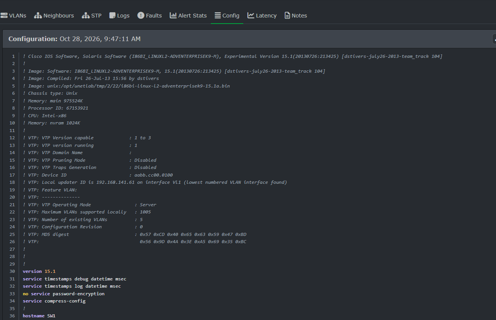

# 04 - Oxidized: sao lưu cấu hình và lưu phiên bản bằng Git

Oxidized đăng nhập SSH vào từng thiết bị theo chu kỳ, chạy `show running-config` (cùng vài lệnh `show` phụ để ghi thông tin phiên bản vào phần comment) và lưu kết quả vào kho Git. Cấu hình **có thay đổi** thì tạo commit mới, nên mỗi thiết bị có lịch sử đầy đủ.

## Cấu hình

| File | Vai trò |
|---|---|
| [docker/oxidized/config.example](../docker/oxidized/config.example) | Cấu hình chính (copy thành `config`, điền tài khoản) |
| [docker/oxidized/router.db](../docker/oxidized/router.db) | Danh sách thiết bị dạng `tên:IP:model` |
| [docker/compose.yml](../docker/compose.yml) | Service `oxidized`, web/API cổng 8888 |

Các điểm chính trong `config`:

- `model: ios`: cách làm việc với Cisco IOS (prompt, lệnh lấy cấu hình).
- `output: git`: mỗi bản sao lưu có thay đổi là một commit.
- `source: csv`: danh sách thiết bị lấy từ `router.db`.
- `interval: 3600`: sao lưu mỗi giờ. Khi thử nghiệm dùng script ép chạy ngay (bên dưới).
- `rest: 0.0.0.0:8888`: giao diện web và API.

Phân quyền thư mục (container chạy bằng người dùng không phải root, UID 30000):

```
sudo chown -R 30000:30000 docker/oxidized
sudo chmod 600 docker/oxidized/config
```

## Triển khai và kiểm tra

```
cd docker
docker compose up -d
docker compose logs --tail 30 oxidized
curl -s http://localhost:8888/node/fetch/SW1 | head -30
```

Kết quả `curl` trên SW1: phần comment thông tin phiên bản và VTP, rồi `version 15.1`, `hostname SW1`... (đầy đủ `running-config`), xem [evidence/oxidized-fetch-SW1.txt](evidence/oxidized-fetch-SW1.txt).

## Kho Git

Kho nằm ở `docker/oxidized/oxidized.git` (thuộc UID 30000, nên đọc bằng `sudo` và `safe.directory`):

```
sudo git -c safe.directory='*' --git-dir=docker/oxidized/oxidized.git log --oneline
```

Lịch sử thực tế trong lab (xem [evidence/git-log.txt](evidence/git-log.txt)):

```
7140750 (HEAD -> master) update /SW1     <- sau khi thêm description cho cổng
c79e2e4 update /R2                        <- bản sao lưu đầu tiên của R2
dfc5bd6 update /R1                        <- bản sao lưu đầu tiên của R1
422ba16 update /SW1                       <- bản sao lưu đầu tiên của SW1
```

Diff của commit `7140750` (thay đổi cấu hình thật được ghi lại):

```diff
 interface Ethernet0/1
+ description TO-R1
  duplex auto
 !
 interface Ethernet0/2
+ description TO-R2
  duplex auto
```

Ngoài dòng thay đổi thật, diff còn có vài dòng `!` hoặc `! Last configuration change at ... by admin` do thiết bị in ra khác nhau giữa các lần. Đây là nhiễu ở phần comment, không phải thay đổi cấu hình.

## Ép sao lưu ngay khi thử nghiệm

```
curl -s http://localhost:8888/node/next/SW1
```

Lệnh này chỉ xếp thiết bị lên đầu hàng đợi, Oxidized xử lý sau một lúc, thời gian không cố định. Dùng `sleep` cố định có lúc không đủ và bỏ lỡ commit. Script [scripts/oxfetch.sh](../scripts/oxfetch.sh) gọi lệnh trên rồi **chờ đến khi Git có commit mới** (tối đa 2 phút):

```
scripts/oxfetch.sh R1
```

## Tích hợp vào LibreNMS

**Settings (bánh răng) > External Settings > Oxidized Integration:**

| Ô | Giá trị |
|---|---|
| Enable Oxidized support | bật |
| URL to your Oxidized API | `http://oxidized:8888` |
| Enable config versioning access | bật |

LibreNMS gọi Oxidized bằng tên container `oxidized` vì hai container chung mạng Docker của dự án. Kết quả: trang thiết bị trong LibreNMS có thêm tab **Config** hiển thị cấu hình đã sao lưu (đã kiểm tra trên SW1; tên `SW1` trong `router.db` được ghép đúng với thiết bị `192.168.141.61`).



## Lưu ý bảo mật

Cấu hình sao lưu chứa thông tin nhạy cảm: community SNMP, hash mật khẩu (`username admin ... secret 4 ...`). Vì vậy kho Git `oxidized.git` **không** được đưa lên GitHub (đã nằm trong `.gitignore`). Ảnh chụp cấu hình phải che các phần này.

## Bằng chứng

- [x] `evidence/oxidized-fetch-SW1.txt`: cấu hình SW1 lấy qua API
- [x] `evidence/git-log.txt`: lịch sử commit
- [x] `evidence/librenms-config-tab-sw1.png`: tab Config trong LibreNMS
- [ ] Ảnh giao diện web Oxidized `http://192.168.141.131:8888` (3 thiết bị, trạng thái)
- [ ] Ảnh `docker compose ps` đủ container
